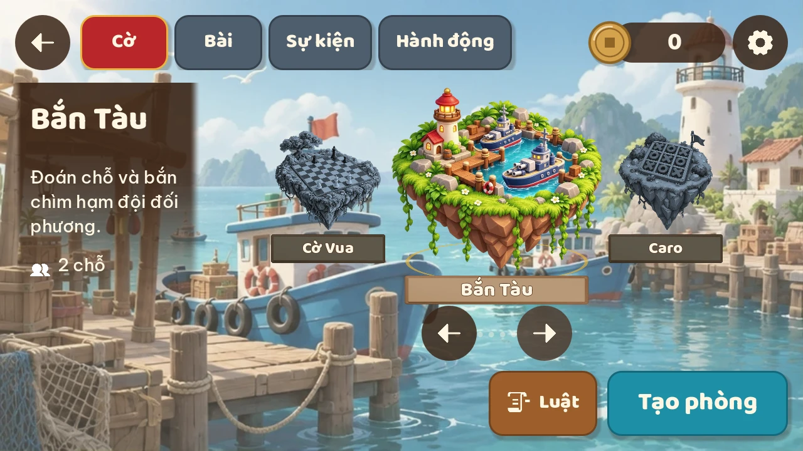
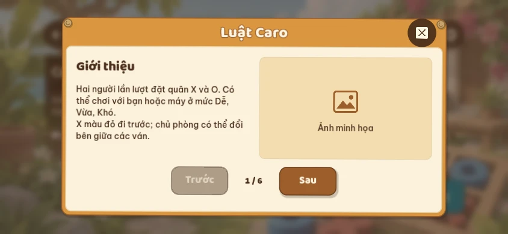
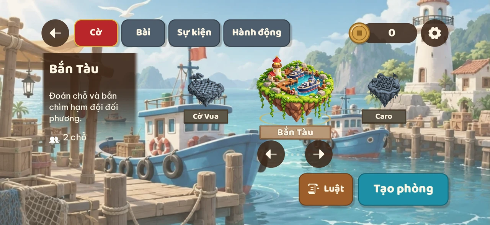

# Concept màn chọn trò: bố cục tham khảo Arknights, hình ảnh Xóm Đảo

Trạng thái: đã triển khai theo yêu cầu. Chỉ tham khảo tổ chức giao diện của Arknights; hình ảnh theo Xóm Đảo.

## Hướng hình ảnh

Chỉ tham khảo cách tổ chức giao diện của Arknights: game focus ở giữa, game trước/sau hai bên, thông tin bên trái, hành động dưới phải và luật trong popup lớn. Phong cách nghệ thuật tiếp tục theo [hướng nghệ thuật Xóm Đảo](../art-direction.md): đảo đồ chơi Việt 2.5D, khối mềm, màu tươi, nắng trên trái, gỗ mật ong, giấy dó, sơn mài và chữ tròn Baloo 2/Be Vietnam Pro. Giữ bảng màu và bộ UI hiện có; Tạo phòng dùng xanh biển sâu, Luật dùng gỗ tối. Không đưa cạnh cắt chéo, typography quân sự, UI đen trắng/cyan hay nút vàng của Arknights vào sản phẩm.

## Màn chọn trò

| Vùng | Nội dung |
| --- | --- |
| Trên cùng | Giữ thanh tab Cờ, Bài, Sự kiện, Hành động và các nút quay lại, tiền, cài đặt |
| Giữa | Ba game trong một băng chuyền: game đang focus lớn ở giữa, game trước/sau nhỏ hơn ở trái/phải |
| Bên trái | Tên game, mô tả ngắn và số chỗ; lớp nền nâu đậm trong mờ ở trên, trong dần xuống dưới |
| Dưới phải | Nút Tạo phòng lớn, rõ; nút Luật có icon cuộn giấy ngay bên trái |
| Toàn màn | Splash art riêng của game đang focus, phủ kín nền và được giảm tương phản để UI dễ đọc |

- Chạm đảo bên cạnh, vuốt ngang hoặc dùng mũi tên sẽ đưa game đó vào giữa.
- Game giữa có màu đầy đủ, quầng vàng ấm nhẹ và animation. Hai game bên cạnh chỉ dùng ảnh tĩnh, giảm bão hòa và nhuộm xám xanh.
- Mỗi lần đổi focus, tên/mô tả/số chỗ và nền splash đổi đồng bộ theo game.
- Nút Tạo phòng vẫn mở bảng tùy chỉnh phòng hiện có của game trước khi tạo phòng thật.
- Không đặt nút Chọn hoặc Danh sách phòng vào màn này.
- Nếu thể loại chỉ có một hoặc hai game, chỉ hiện số đảo có thật; không nhân đôi game để lấp ba vị trí.
- Danh sách game chạy vòng khi đủ game; game Sắp có vẫn thể hiện trạng thái khóa và không tạo phòng được.
- Sự kiện giữ luồng Tham gia và phần thưởng đang có, với cùng cách focus/trình bày; không ép sự kiện vào luồng phòng.

## Chuyển động

- Focus: đảo nổi nhẹ 4 đơn vị theo chu kỳ 3,2 giây.
- Chỉ game giữa chạy animation; game bên cạnh dừng animation và hiệu ứng hạt. Khi đổi focus, dừng hiệu ứng cũ rồi bật hiệu ứng của game mới.
- Đổi game: tween vị trí/kích thước/màu trong khoảng 300 ms; splash nền chuyển mờ khoảng 350–450 ms.
- Tạm dừng animation nền/focus khi popup luật mở; đóng popup thì tiếp tục.
- Test xác minh chỉ đảo focus chuyển động; mở bảng luật hoặc tạo phòng thì tạm dừng.

## Asset và kỹ thuật

- Đảo mỗi game dùng artwork riêng có alpha. Tái sử dụng ảnh đảo hiện có; Godot chạy chuyển động nổi ở game đang focus.
- Splash nền là ảnh phong cảnh riêng cho từng game, không phải sprite hiệu ứng mang tên splash trong asset gameplay.
- Bỏ khung thẻ dọc Runeterra. Bảng tên/đế dùng chung giữ khối mềm và vật liệu Xóm Đảo, dựng/bake bằng Blender khi cần khối 3D; hiệu ứng focus do Godot vẽ. Không dùng bracket kỹ thuật hay khung hologram.
- Xuất nền/ảnh đảo ở kích thước đủ cho màn ngang và giữ chủ thể trong vùng crop an toàn.
- Chuẩn bị đường tải artwork của hub để thấy được đảo và splash trước khi tải toàn bộ gói game.
- `HubGameSelect` dùng `HubGameCarousel` cho stage ba đảo và đặt nhóm hành động riêng dưới phải.
- Áp dụng shader gradient alpha cho panel trái và shader giảm bão hòa/nhuộm màu cho đảo không focus.
- Scene triển khai: `apps/client/hub/select/`; luật phân trang: `apps/client/hub/room/rules_board.gd`.

## Popup luật

- Khung lớn giữa màn, bo mềm, gỗ mật ong, góc buộc dây thừng và ruột giấy dó; chữ nâu đậm trên giấy. Đồng bộ với bộ UI Xóm Đảo.
- Lớp phủ vừa làm mờ vừa làm tối toàn bộ nền, chặn tương tác với màn phía sau.
- Có tên game, nút đóng, tiêu đề trang, nội dung ngắn, Trước/Sau và số trang.
- Mỗi trang hỗ trợ một vùng art tùy chọn. Hiện để placeholder Ảnh minh họa; sau khi làm lại visual game sẽ thay bằng ảnh chụp gameplay thực tế.
- Placeholder không phải ảnh gameplay giả và không thay đổi luật chơi.
- Nội dung dựa trên `games/<id>/RULES.md`; chia thành trang ngắn, giữ đủ nội dung, có thể tách mục dài thành nhiều trang.
- Không cuộn dọc trong popup. Trang đầu/cuối vô hiệu hóa hướng không còn trang.
- Bố cục hai cột: nội dung bên trái, hình bên phải; đo chiều cao chữ và tiêu đề để chia trang theo khung thực tế.

## Kiểm tra

1. Stage đổi focus bằng chạm/vuốt/mũi tên; tab, nền, mô tả và hành động luôn cùng game.
2. Chỉ đảo focus chuyển động; hai đảo khác tĩnh và xám xanh.
3. Popup luật làm mờ/tối nền, chặn thao tác phía sau, chuyển trang đúng và không tràn chữ.
4. Kiểm tra trường hợp game Sắp có, thể loại ít game và sự kiện.
5. Chụp khổ ngang điện thoại, tablet, desktop, tránh tai thỏ; chữ/vùng chạm theo quy chuẩn UI repo.
6. Chạy godot:check, export/smoke và kiểm tra luồng phòng/luật theo quy định repo.

## Nguồn triển khai

- Prompt asset chính thức: `assets/prompts.json`.
- Sao chép đảo và cắt sheet nền: `node scripts/select-art.mjs`.
- Bảng tên chung: `assets/shared/render_select_label.py` (Blender).
- Ảnh gameplay minh họa luật vẫn là placeholder có chủ đích.
