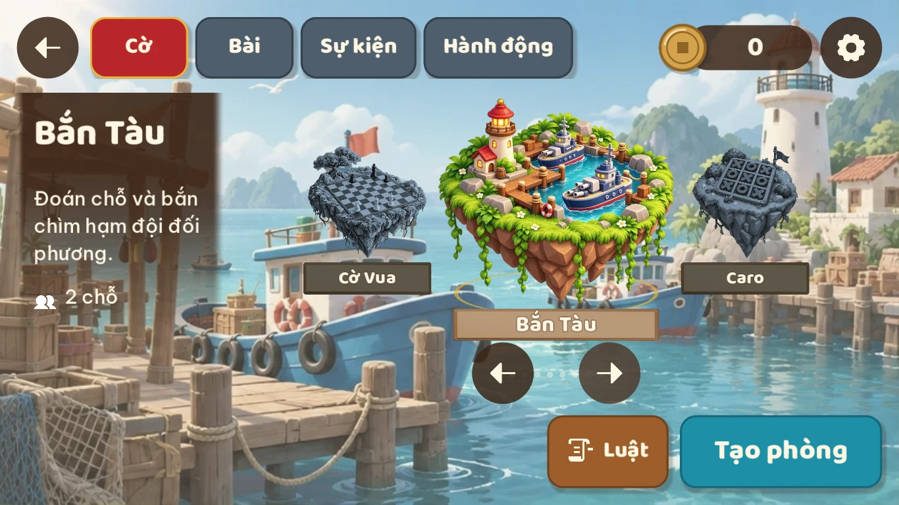

# Xóm Đảo: khung trải nghiệm

> Trạng thái: Phase 0, bản nháp chờ duyệt. Đây là cái khung chung mà hub và **mọi** trò, sự kiện
> sau này phải khớp: thế giới được tổ chức thế nào, HUD nằm đâu, người chơi vào một trò ra sao,
> phần thưởng hiện thế nào, và mọi thứ trông ra sao. Nó không mô tả luật của trò nào.
>
> Ảnh concept trong tài liệu này cho thấy **hướng đi**, không phải bản vẽ chính xác tới từng điểm
> ảnh. Chữ, số và bố cục cụ thể do các bảng và quy tắc bên dưới quyết định. Prompt tạo ảnh:
> [concepts/prompts.json](concepts/prompts.json).
>
> Tầm nhìn: [vision.md](vision.md). Kế hoạch: [roadmap.md](roadmap.md). Giao diện game thật đã
> tham khảo: [ui-references.md](ui-references.md). Khi ảnh concept và tài liệu đó khác nhau, theo
> tài liệu đó: ảnh AI đẹp nhưng không thực tế.
>
> **Hướng nghệ thuật** ở [art-direction.md](art-direction.md). Ảnh sảnh vòng đảo, ván đấu, kết quả,
> Bến và bộ thành phần đã vẽ theo nó. Ảnh chọn trò, Nhà, sự kiện còn theo bản cũ (nút gỗ sáng, chữ
> nối bằng dấu chấm): chỉ xem bố cục.

## Nguyên tắc

1. **Học bố cục từ game mobile nổi tiếng, vẽ lại bằng văn hoá Việt.** Sảnh chờ, chọn chế độ, chọn
   bản đồ, nút "Chơi" to ở góc dưới phải: người chơi game mobile (MOBA, bắn súng sinh tồn) đã quen
   tay. Nhưng mọi thứ là gỗ, tre, dây thừng, sơn mài, giấy dó, nón lá, đèn lồng.
2. **HUD mỏng, hình to, một nút lộng lẫy.** Như game thật: icon và hàng nút nhỏ, phẳng, nền trong
   mờ; cảnh và nhân vật chiếm phần lớn màn hình; chỉ nút CHƠI và vài bảng lớn được làm bằng gỗ, sơn
   mài, dây thừng.
3. **Trong ván, màn hình là của trò.** Phần khung (shell) chỉ giữ một nút menu nhỏ ở góc trên trái.
4. **Một lần chạm để vào chơi.** Nút **CHƠI** ở sảnh luôn mang trò đang chọn (mặc định là trò vừa
   chơi). Đổi trò là việc riêng, không chặn đường vào chơi.
5. **Một ngôn ngữ hình ảnh.** Mọi trò, mọi sự kiện dùng chung vật liệu, bảng màu, font, nút và âm
   thanh giao diện. Mỗi trò có "chất" riêng trong thẻ trò và bàn chơi của nó, không phải trong HUD.
6. **Mọi chuyển cảnh đều có chuyển động.** Không màn trắng, không vòng xoay tải giữa màn hình.

## Sảnh: vòng đảo thể loại


Thế giới có ba tầng, giống "chế độ chơi" và "bản đồ" của game mobile:

| Tầng | Giống trong game mobile | Ở Xóm Đảo |
| --- | --- | --- |
| **Sảnh** | Sảnh chờ, chọn chế độ ngay trên đó | Bầu trời có **vòng đảo thể loại** bay lơ lửng, xoay được |
| **Thể loại** | Chế độ chơi (Cổ điển, Giải trí…) | Một **đảo thể loại** trên vòng: Cờ, Bài, rồi các thể loại phụ |
| **Trò** | Bản đồ trong một chế độ | Một **thẻ trò** trong dãy thẻ của thể loại |

Sảnh không có đảo trung tâm cố định hay nhân vật. Các đảo thể loại là đảo bay, cùng cỡ, xếp đều trên
một vòng tròn nằm nghiêng giữa trời, nhìn chéo từ trên như một băng chuyền. Nền là núi đá vôi kiểu
Việt Nam, mặt nước, chùa xa và mây nhẹ, nhạt màu để không tranh với HUD:

- Vuốt ngang hoặc chạm một đảo để **xoay vòng**. Đảo ở chính giữa phía trước là **đảo đang chọn**:
  to nhất, đủ màu (cây xanh, mái đỏ, nắng vàng phía sau) và có bảng tên. Các đảo khác nhỏ dần và
  ngả xám xanh theo độ xa, không có bảng tên. Đảo bị khoá chìm trong sương trắng dày, có ổ khoá.
  Đảo nào cũng bồng bềnh nhẹ.
- Đảo đang chọn quyết định thẻ "trò đang chọn" ở dưới phải. Chạm lại đảo đang chọn, hoặc chạm thẻ,
  thì mở màn chọn trò của thể loại đó.
- **Cờ** và **Bài** là hai thể loại chính: luôn đứng đầu vòng theo thứ tự. Các thể loại phụ nối
  tiếp theo thứ tự trong danh sách thể loại.

| Đảo | Trò |
| --- | --- |
| **Cờ** | Cờ Tướng, Cờ Vua, Cờ Vây, Cờ Đam, Caro, Cờ Cá Ngựa, Cờ tỷ phú, Bắn Tàu |
| **Bài** | Tiến Lên, Mậu Binh, Bài Cào |
| **Sự kiện** | Trò của sự kiện đang mở |
| **Hành động** | Bom Nguyên Tố |

Khi chưa có thể loại phụ nào, vòng có thêm đảo **Sắp có**: đảo sương mù có ổ khoá, chưa có trò.

Vòng nhận bao nhiêu đảo cũng được: đảo càng nhiều thì vòng càng rộng và đảo phía sau càng nhỏ, nhưng
đảo đang chọn luôn cùng cỡ. Chạm Sắp có chỉ hiện thông báo nhanh "Sắp có".

Quy tắc dữ liệu:

- Danh sách thể loại là dữ liệu của phần lõi (id, tên, ảnh đảo, thứ tự, và **chính** hay **phụ**).
  Hai thể loại chính đứng đầu vòng; thể loại phụ nối theo thứ tự. Thêm một thể loại phụ là thêm
  một dòng và một ảnh đảo; không sửa code sảnh.
- Mỗi trò khai báo nó thuộc thể loại nào. Thêm một trò là thêm một thẻ; không ai vẽ lại sảnh.
- Thể loại chưa có trò nào `ready` cũng hiện là đảo sương mù có ổ khoá. Khi chưa có thể loại phụ
  nào, vòng có thêm đảo Sắp có sau Bài.

Bố cục HUD ở sảnh:

Sảnh theo bố cục ba cột của client game PC (League of Legends), vẽ hoạt hình phẳng:

| Vùng | Chứa |
| --- | --- |
| Cột trái | Khay nổi bo tròn ở mép trái: **Sảnh** (hình hòn đảo, đang chọn, trên tấm vàng nổi, hình nhấp nhô), Chợ, Đình, Bến; mỗi nút một hình minh hoạ có chữ dưới |
| Trên trái | Ảnh đại diện (hình của tài khoản, trong khung đang dùng) đè lên đầu một tấm xanh đậm; trên tấm là tên, dưới tên là một thanh bắt đầu bằng chip cấp rồi tới kinh nghiệm → **Nhà** |
| Trên phải | Xu, hộp thư, quà, ⚙ |
| Phải, dưới thanh trên | Lối tắt, tấm phẳng xanh đậm viền mảnh: **Chợ** (tranh phủ kín tấm), **Sự kiện** (hình hộp quà; chấm đỏ và số ngày còn lại khi có sự kiện), **Nhiệm vụ** (hình bảng kẹp) |
| Góc dưới phải | Thẻ trò đang chọn, hai góc bo lớn và hai góc bo nhỏ: tranh của trò phủ kín thẻ, tối ở phía trên; tên trò viết thẳng lên tranh ở góc trên trái, số đang chơi ở góc trên phải, không có nền. **CHƠI** là một tấm vàng lớn chiếm trọn đáy thẻ, vát góc trên trái, ghi kèm số người của trò (`2–4 người`). Không ghi thời lượng, không có nút Tạo phòng ở sảnh |
| Giữa | Vòng đảo thể loại, phần lớn màn hình |

Mắt đi theo thứ tự: đảo giữa → thẻ trò đang chọn → **CHƠI**.

HUD sảnh: nền xanh navy đậm trong mờ, chữ và icon màu kem; mục đang chọn là bảng vàng có viền sáng
và quầng nhẹ; nút chính vàng, nút phụ xanh dương sáng. Thẻ và lối tắt bo góc, viền mảnh, bóng nhẹ.
Phong bì mở **Hộp thư** (xem dưới), có chấm đỏ khi có thư chưa đọc hoặc quà chưa nhận. Quà và
Nhiệm vụ mở bảng **Nhiệm vụ hằng ngày** (xem dưới); cả hai có chấm đỏ khi có phần thưởng chờ nhận.

Các màn khác ngoài sảnh và ván đấu (chọn trò, Nhà, Chợ, Bến, kết quả) chỉ có ← ở trên trái và hàng
icon tiền + ⚙ ở trên phải.

Các nơi chốn giữ tên làng: **Nhà** (hồ sơ, túi đồ), **Chợ** (cửa hàng), **Đình** (tin tức, xếp
hạng chung), **Bến** (phòng đang mở, bạn bè online, lời mời). Chợ, Đình, Bến là nút ở cột trái
của sảnh; Nhà mở bằng cách chạm ảnh đại diện.

## Đường đi của người chơi

```
Mở game ─► Sảnh (vòng đảo)
  │
  ├─ CHƠI ──────────────────────────► Phòng ─► Ván đấu ─► Kết quả ─┬─► Chơi tiếp
  │   (trò đang chọn)                                               └─► về Sảnh
  │
  ├─ xoay vòng ─► đảo đang chọn đổi, thẻ dưới phải đổi theo
  ├─ chạm đảo đang chọn / thẻ trò đang chọn
  │      ▼
  │   Chọn trò: dãy thẻ trò của một thể loại + hàng thể loại dưới trái
  │      ├─ Chạm thẻ trò ─► Phòng (có mã phòng, tuỳ chọn, Luật) ─► Ván đấu
  │      └─ Chạm thẻ sự kiện ─► bảng sự kiện (điểm, mốc thưởng, Tham gia)
  │
  ├─ Bến ─► Nhập mã phòng / danh sách phòng / bạn bè đang online / lời mời
  │
  └─ Nhà / Chợ / Bến / Sự kiện …  ─► màn nơi chốn ─► ← về Sảnh
```

- **CHƠI** mở ngay một phòng của bạn cho trò đang chọn, với tuỳ chọn mặc định của trò. Mọi việc
  còn lại làm trong phòng: đổi tuỳ chọn (kể cả cho máy ngồi), mời bạn, bắt đầu.
- **Phòng** chia hai bên. Bên trái là tấm giấy ghi mọi thứ về phòng: tranh và tên trò, nút cuộn
  giấy mở bảng **Luật**, mã phòng với **Mời bạn**, và các tuỳ chọn của trò. Chủ phòng đổi được
  tuỳ chọn, người khác chỉ đọc. Bên phải là các ghế, mỗi ghế một thẻ xếp thành lưới: ảnh, tên,
  và vai (Chủ phòng, Máy, Sẵn sàng); ghế trống chạm vào là sao chép link mời.
- Góc dưới phải của phòng có đúng một nút lớn: **Bắt đầu** cho chủ phòng, **Sẵn sàng** cho người
  khác. Chủ phòng chỉ bắt đầu được khi mọi người khác đã sẵn sàng; máy luôn sẵn sàng. Sau một
  ván, **Chơi tiếp** không cần sẵn sàng lại.
- Ghép nhanh (`room:quick`: vào phòng đang chờ, không ai tới thì máy ngồi ghế trống) vẫn có ở
  màn chọn trò.
- **Màn chờ** (đang kết nối, đang tải một trò) là băng chuyền tranh của các trò: mỗi tranh kèm
  tên trò và vài dòng về gốc gác của trò đó, tự chuyển sau vài giây, chạm hoặc vuốt để chuyển
  sớm. Khi tải một trò thì mở đầu bằng tranh của chính trò đó. Trạng thái nằm ở góc dưới phải.
  Thêm trò mới thì thêm một dòng vào `SLIDES` trong `apps/client/hub/loading.gd`.
- **Chờ máy chủ**: khi mở một bảng hay làm một việc cần máy chủ trả lời (Chợ, Nhà, Đình, Nhiệm
  vụ, nhận thư, bạn bè) mà câu trả lời tới chậm hơn khoảng một phần ba giây, một huy hiệu "Đang
  tải" có vòng xoay hiện ở giữa cạnh dưới, trên một dải xanh đậm nhạt dần lên trên. Huy hiệu không
  chặn thao tác và đã hiện thì ở lại ít nhất gần nửa giây cho khỏi chớp. Màn mới gọi máy chủ qua
  `HubWait.ask` (`apps/client/hub/wait.gd`); việc chạy ngầm thì gọi thẳng client.
- **Chuyển màn**: các nơi chốn trong sảnh (Chọn trò, Nhà, Chợ, Đình, Bến) và nút ← đổi màn ngay lập
  tức để thao tác nhanh gọn. Tấm màn xanh đậm viền vàng quét chéo mang logo và tên trò khi vào
  phòng. Bấm Bắt đầu thì tới **màn riêng của trò**: tranh splash phủ kín, logo và tên trò ở giữa,
  vòng xoay "Đang tải"; màn này ở lại ít nhất gần hai giây rồi mờ dần sang bàn chơi.
- Nút ← luôn về đúng một bước. Từ ván đấu về sảnh có hỏi xác nhận nếu đang giữa ván.
- Chơi với bạn bè: phòng nào cũng có **mã phòng** ngắn. Gửi mã hoặc link mời; bạn bè nhập mã ở Bến
  hoặc mở link là vào thẳng phòng. Nếu ván đã bắt đầu, họ vào xem với tư cách khán giả. Thoát ra thì
  về sảnh, với trò đó đang được chọn.

## Khung hình

Giữ hệ khung của [ui-guide.md](ui-guide.md#khung-hình): bốn khung **cố định cao 720 đơn vị**, tỉ lệ
**16:9, 18:9, 19.5:9 và 20:9**; lõi **960 × 720** nằm giữa. Chỉ chơi màn hình ngang.

Trong Godot: kích thước gốc 1280 × 720, `stretch/mode = canvas_items`, `stretch/aspect = keep`.
Ứng dụng tự chọn khung phủ nhiều diện tích màn hình nhất, giữ viền đen ở phần thừa và không mở
khung tự do; HUD tránh vùng an toàn (safe area).

Cỡ tối thiểu (vùng chạm 88, chữ nhỏ nhất 24…) theo bảng
[Đơn vị và cỡ tối thiểu](ui-guide.md#đơn-vị-và-cỡ-tối-thiểu).

## HUD trong ván


> Ảnh concept này chỉ để xem không khí. Bố cục theo các quy tắc dưới đây, rút từ Ludo King và
> Stumble Guys ([ui-references.md](ui-references.md#trong-trận)). Người chơi trên máy luôn ở
> **dưới**; ảnh lại vẽ Minh ở trên.

**Phần khung chỉ giữ một thứ: nút menu ☰** ở góc trên trái (88 × 88, sát mép). Menu mở một bảng
chung: cài đặt (tab Giao diện: cỡ giao diện, lề, chất lượng hình; tab Âm thanh: nhạc và hiệu ứng
riêng), rời phòng, luật chơi, biểu cảm. Trò
để trống ô vuông đó, còn lại cả màn hình là của trò.

Trò chọn một trong hai bố cục mẫu, để các trò cùng loại trông giống nhau:

| Bố cục | Giữa | Góc và hai bên | Dưới |
| --- | --- | --- | --- |
| **Bàn** (cờ, bài) | Bàn chơi vuông, cao gần trọn khung | Ô người chơi của đối thủ ở các góc hoặc hai bên, sát chỗ ngồi của họ (như Ludo King) | Người chơi trên máy: bài trên tay hoặc ô của mình; nút hành động (Đánh, Bỏ lượt) ở dưới phải |
| **Hành động** (trò hành động như Bom Nguyên Tố, sự kiện) | Cảnh chơi | Mục tiêu trên trái (dưới nút ☰), bộ đếm/thời gian trên phải | Cần điều khiển dưới trái, nút hành động dưới phải |

- Ô người chơi dùng thành phần chung: ảnh đại diện, tên, cấp, vòng thời gian vàng cho người đang
  tới lượt, 👑 cho chủ phòng. Thông tin riêng của trò (số lá bài, xúc xắc) nằm trong ô đó.
- Các mảnh HUD chung (ô người chơi, chip, nút, nút ☰) **khoác vật liệu của bàn** (`table_skin()`):
  hình dạng và cỡ giữ nguyên, chỉ đổi màu và viền cho hợp thế giới của trò, ví dụ gỗ sơn mài
  viền đồng và chip giấy đỏ trên chiếu Tết của Tiến Lên, gỗ óc chó dưới đèn dầu ở Bài Cào, khăn
  chàm viền đồng ở Mậu Binh, thép xanh viền đồng thau ở Bắn Tàu, giấy vở mực xanh ở Caro. Không
  để một tấm tên tối hay chip xanh lá mặc định lạc giữa bàn.
- Người đang tới lượt nổi rõ; ở trò nhiều người đi lần lượt (Tiến Lên), ô của những người khác
  lùi lại (mờ đi một chút).
- Trò bài **đổi bố cục theo pha** để người chơi luôn tập trung vào thứ đang quan trọng: lúc tự xếp
  hay nặn bài thì người khác thu thành dải thẻ nhỏ trên cùng và bài của mình to giữa bàn; lúc so
  bài thì bàn thu lại thành cột (hoặc nhà cái đối diện hàng người chơi), lật lần lượt từng người.
  Chuyển pha bằng chuyển động trượt, không nhảy cảnh.
- **Điều khiển**: trên máy tính có phím tắt cho việc lặp lại (đánh, bỏ lượt, cược, lật bài, gieo
  xúc xắc, ngắm và bắn), ghi ở tooltip của nút; không làm phím cho từng quân cờ. Trên điện thoại,
  vùng chạm tối thiểu khoảng 64 đơn vị; lưới nhỏ hơn thế thì chạm hai bước (chạm đánh dấu, chạm lại
  để đi) hoặc nhấn giữ có kính lúp (cờ vây).
- Nút hành động theo mức rủi ro: nút chính nổi nhất (Đánh, Xong, Lật bài), nút phụ trầm (Bỏ lượt,
  Tự xếp), nút nguy hiểm (Đầu hàng) màu trầm và tách ra một khoảng.
- Trong ván không hiện tên trò, tên phòng hay số dư xu.
- Biểu cảm: chạm vào ô của mình, hoặc mở từ menu.

## Chọn trò



Ảnh concept trên là bố cục cũ (ba đảo trò); bố cục hiện tại như mô tả dưới đây.

- Trên cùng chỉ có quay lại, số xu và cài đặt.
- Giữa là **dãy thẻ trò** của thể loại đang chọn, treo trên một thanh ngang. Mỗi thẻ là một tấm
  ảnh viền giấy: tranh splash của trò phủ kín, **logo** phẳng của trò ở giữa, tên trò và một dòng
  mô tả bên dưới, tối dần xuống đáy cho dễ đọc. Phía trên mỗi thẻ có nhãn số người treo vào thanh.
  Không dùng đảo ở màn này.
- Kéo ngang (hoặc lăn chuột) để trượt dãy thẻ; thả tay thì dãy trôi thêm một đoạn. Dãy ngắn hơn
  màn hình thì nằm giữa và không trượt.
- **Chạm một thẻ là chọn xong**: vào thẳng phòng của trò đó. Không có nút Tạo phòng. Trò sắp có
  bị phủ mờ, có ổ khóa và không chạm được. Thẻ sự kiện mở **bảng sự kiện** với điểm, các mốc
  thưởng và **Tham gia**.
- **Thể loại** nằm ở góc dưới trái, xếp ngang. Mỗi thể loại là một **vật** đứng trên một tấm nền
  có tên (quân xe cho Cờ, lá bài cho Bài, đèn lồng cho Sự kiện, quả bom cho Hành động): vật cao
  hơn tấm nền nên nhô lên khỏi nó. Thể loại đang chọn có nền vàng và vật nhún nhẹ.
- Logo trò và vật thể loại là SVG phẳng trong `apps/client/hub/select/logo/` (`<id>.svg`,
  `genre-<id>.svg`). Trò mới cần thêm một logo; thể loại chưa có vật thì dùng viên xúc xắc.
- **Luật** mở bảng gỗ lớn giữa màn, làm mờ/tối và chặn nền. Nội dung `RULES.md` được chia trang
  theo chiều cao thực tế; có Trước/Sau, số trang, vuốt ngang và phím mũi tên. Mỗi mục có thể có
  hình minh họa; hiện để ô **Ảnh minh họa**, chờ ảnh gameplay sau khi làm lại visual từng trò.
  Chạm ngoài bảng hoặc đóng để trở về. Bảng mở từ nút cuộn giấy trong phòng, hoặc từ ☰ trong ván.

Tuỳ chọn của trò (số người, luật phụ, máy) nằm trên tấm giấy của phòng. Mỗi tuỳ chọn được vẽ theo
kiểu hợp với nó, nên không hàng nào rộng hơn tấm giấy: cặp Tắt/Bật là **công tắc**; con số (số
máy, số vòng, số giây) là **− giá trị +**; vài chữ ngắn chia đều hàng thành **các ô**; chữ dài thì
là **‹ giá trị ›**, mỗi lần một lựa chọn.

Danh sách phòng (từ **Bến**) là một bảng gỗ, mỗi dòng: tranh nhỏ của trò,
tên trò, chủ phòng và số ghế là hai chip riêng. Phòng còn ghế có nút **Vào**; ván đang chơi có
nút **Xem** để vào làm khán giả, không chiếm ghế. Phòng chờ đã đủ ghế vẫn không nhận thêm người
chơi. Bến có thêm ô nhập mã phòng:


### Bạn bè

Bến có hai tab ở giữa thanh trên: **Phòng** (như trên) và **Bạn bè**. Tab Bạn bè ghi số lời mời và
tin nhắn đang chờ ("Bạn bè (2)"); khi có thì vào Bến là mở thẳng tab này, và nút Bến ở sảnh có
chấm đỏ.

- Bên trái: ô **Tên đăng nhập** với nút kết bạn, rồi danh sách theo nhóm: **Lời mời kết bạn**
  (Đồng ý / ✕), **Bạn bè** (người đang online lên đầu, có chấm xanh trên ảnh; dòng dưới tên ghi
  "Đang chơi Tiến Lên", "Đang online" hoặc "Không online"; số tin chưa đọc ở bên phải), **Đã gửi
  lời mời** (✕ để huỷ). Mời một người đã mời mình thì thành bạn luôn.
- Bên phải: trò chuyện với người bạn đang chọn. Đầu khung là ảnh, tên, đang ở đâu, nút **Vào
  phòng** khi bạn ấy đang ở một phòng, và **Xoá bạn** (hỏi lại "Chắc chưa?"). Tin của mình là bong
  bóng vàng bên phải, của bạn là bong bóng xanh bên trái. Enter để gửi; tin tối đa 300 ký tự.
- Chỉ nhắn được cho bạn bè; trong ván vẫn chỉ có biểu cảm.
- Trong phòng chờ, **Mời bạn** mở bảng các bạn (người online có nút **Mời**, người khác mờ đi) và
  nút **Sao chép link** cho cách mời cũ. Người được mời thấy một thẻ trượt xuống từ trên: ảnh,
  "Lan mời bạn chơi Tiến Lên", nút **Vào** và ✕; thẻ tự đi sau khoảng 14 giây.

## Kết thúc ván và phần thưởng


- **Khoảnh khắc kết thúc** luôn đến trước bảng kết quả, ở mọi kiểu kết thúc (thắng, thua, hoà,
  đầu hàng, đối thủ rời phòng, hết giờ):
  - Trò có màn kết thúc riêng (`wait_for_result_panel()`) tự diễn và tự phát âm thanh thắng/thua;
    hub chờ trò xong, tối đa 8 giây, rồi mới đưa bảng lên. Hub không phát thêm tiếng thắng/thua.
  - Trò không có thì hub diễn màn mặc định: dừng khoảng 0,8 giây cho nước cuối kịp hiện, rồi một
    dải lụa sơn mài giữa bàn chừng 1,6 giây: "Thắng rồi!" (đỏ sơn mài viền vàng đồng, vụn vàng bay
    ra, tiếng thắng), "Thua rồi" (xám xanh, rơi xuống hơi lệch, tiếng thua), "Hoà" (gỗ mật ong).
    Người xem thấy "<tên> thắng" trên dải xanh biển. Chạm để bỏ qua.
  - Vào lại một phòng đã xong ván thì bảng hiện luôn, không diễn lại.
- Bảng kết quả **đi lên** chứ không bật ra: nền tối dần, bảng trồi từ dưới lên hơi nảy, các dòng
  hiện lần lượt, xong mới tới xu bay (khoảng nửa giây). Lúc này chỉ có tiếng giấy.
- Mỗi trò có thể **khoác áo** cho bảng bằng `result_theme()`: màu giấy, màu chữ, màu nhấn (dòng
  tiêu đề và hàng của bạn), màu nền tối, tên bảng thay cho "Hết ván" (ví dụ "Tàn cuộc") và một
  hình nhỏ của trò ở đầu bảng.
- Phần khung vẽ bảng kết quả. Trò chỉ trả về **thứ hạng** và tuỳ chọn một dòng tóm tắt
  ("Tới trắng!", "Thắng 3 cây"). Trò nào cần màn kết quả riêng (bảng điểm chi tiết) thì khai báo,
  và vẫn phải kết thúc bằng phần phần thưởng chung.
- Phần thưởng do server tính (sổ cái). Xu và tài nguyên **bay** từ bảng vào góc trên phải, số dư
  đếm lên. Có âm thanh xu rơi.
- Hai nút: **Chơi tiếp** (ván mới, cùng phòng) và **Về sảnh**. Ảnh concept còn ghi "Về đảo".
- Khi chọn **Xem bàn**, bảng kết quả ẩn và nút **Kết quả** nằm ở góc dưới phải để mở lại; game có
  thể dùng viền nút phù hợp với bàn chơi của mình.

## Nhà: hồ sơ, túi đồ, thành tích, lịch sử


- Mở từ ảnh đại diện ở góc trên trái, hoặc nút Nhà ở hàng dưới trái.
- Bốn trang, chọn bằng **chồng thẻ dọc ở mép trái**: Hồ sơ, Túi đồ, Thành tích, Lịch sử. Thẻ
  đang chọn có nền vàng. Bên phải là một tấm giấy lớn hiện trang đang chọn. (Ảnh concept trên là
  bố cục cũ.)
- **Hồ sơ**: ảnh đại diện lớn trong khung đang dùng, tên, chip cấp với thanh tiến độ, ba ô số (số
  ván, số thắng, tỉ lệ thắng), và khung, lưng bài đang dùng. Tên trong game và username nằm cùng
  một hàng; biểu tượng bút mở sửa tên, biểu tượng dấu tích lưu, dấu x hủy. Có thể thay tên trong
  game bất cứ lúc nào (từ 1 đến 20 ký tự). Nút **Đổi diện mạo** mở Túi đồ để chọn ảnh đại diện
  hoặc khung khác.
- **Lịch sử** là danh sách các ván đã xong, mới nhất ở trên: kết quả (Thắng, Thua, Hoà), tên trò,
  chơi với ai, cách đây bao lâu và ván kéo dài bao lâu. Chỉ Nhà của chính bạn có trang này. Xếp
  hạng xem ở Đình.
- **Túi đồ** là lưới các ô vuông bằng nhau, mỗi ô chỉ có hình vật phẩm; món đang dùng có dấu tích
  xanh. Góc trên phải là hàng **loại**: Tất cả, Ảnh đại diện, Khung, Lưng bài, Biểu cảm. Chạm một ô thì một **ngăn kéo**
  trượt ra từ bên phải, ghi hình lớn, tên và loại của món đó, cùng nút hành động hợp với nó: đồ
  trang trí có **Dùng** (hoặc "Đang dùng"). Chạm lại ô đó hoặc nút ✕ để đóng. Ở Nhà người khác
  ngăn kéo chỉ để xem. Vật phẩm nào cũng có biểu tượng vuông, nền trong suốt, để đặt được vào ô.
- **Thành tích** có tổng số đã đạt và thanh tiến độ chung. Hàng lọc cuộn ngang dùng logo đơn sắc
  làm biểu tượng cho Tất cả, Xóm Đảo và từng trò; chạm logo để xem riêng nhóm đó, không cần nhãn
  loại bằng chữ. Danh sách cuộn dọc, thành tích đã đạt đứng trước; mỗi hàng có logo trò, tên,
  tiến độ và xu thưởng.
- Cấp tính từ kinh nghiệm: 10 cho mỗi ván, cộng kinh nghiệm của mỗi thành tích đã đạt. Cấp N bắt
  đầu ở 50 × N × (N − 1) (cấp 2 ở 100, cấp 3 ở 300). Thanh tiến độ dưới chip cấp cho biết còn bao
  xa tới cấp sau.
- Thành tích là hàng trong danh sách: logo trò đơn sắc, tên, thanh tiến độ cùng "Đã đạt" hoặc số
  đếm như "3/10", và xu thưởng. Thành tích đã đạt đứng trước.
- **Ai cũng chơi bằng tài khoản, không có khách.** Chưa đăng nhập thì ứng dụng mở ra bảng **Vào
  Xóm Đảo** trên nền màn chờ, không đóng được, với hai lựa chọn:
  - **Đăng nhập**: tên đăng nhập và mật khẩu.
  - **Tạo tài khoản**: thêm tên trong game.
  Vào được rồi thì mới tới sảnh. Lần sau thiết bị nhớ đăng nhập. Người từng chơi như khách ở bản
  cũ cũng phải tạo tài khoản; dữ liệu của tài khoản khách cũ không chuyển sang.
- Nút **Tài khoản** nằm dưới các thẻ bên trái (chỉ ở Nhà của mình): hiện tên đăng nhập và nút
  **Đăng xuất**, bấm xong thì quay lại bảng Vào Xóm Đảo.

## Chợ: đồ trang trí

- Chợ bán ảnh đại diện, khung, lưng bài và biểu cảm bằng xu. Ba ảnh đại diện khởi đầu và biểu cảm
  Vui vẻ miễn phí; các món còn lại có giá riêng.
- Nút mua hiện icon xu kèm giá. Hàng có thể lọc theo **Tất cả**, **Chưa có** và **Đã có**. Món đã có
  không thể mua lần nữa; sau khi mua, món xuất hiện trong Túi đồ. Ảnh đại diện, khung và lưng bài
  có thể trang bị; biểu cảm
  được gửi trong ván và mỗi game tự vẽ theo bàn chơi của mình.
- Khi máy chủ đang ngủ (gói miễn phí), màn đầu ghi "Đang đánh thức máy chủ" và thử lại tới hai
  phút. Khi máy chủ đã lên bản protocol mới, màn đầu ghi "Đã có bản mới" kèm nút **Tải lại**.

## Đình: xếp hạng

- Bên trái là ngôi đình nổi trên mặt nước, dưới có tấm biển sơn son "Đình làng". Bên phải là một
  bảng gỗ "Xếp hạng" với tab Cả xóm rồi từng trò.
- Ba người đầu đứng trên bục vinh danh (nhì, nhất, ba từ trái sang): ảnh đại diện, tên, con số
  xếp hạng, bậc bục vàng, bạc, đồng ghi hạng. Hạng 1 đội vương miện. Ai bằng điểm thì cùng hạng
  và cùng màu bục.
- Từ hạng 4 trở đi là các hàng: hạng, ảnh đại diện, tên và con số xếp hạng.
- Tên bạn ghi thêm "(bạn)", hàng của bạn tô màu cát; nếu bạn ngoài top, hàng của bạn nằm dưới
  danh sách.
- Hồ sơ của người khác (chạm vào ô người chơi) dùng cùng thẻ, chỉ đọc.

## Nhiệm vụ hằng ngày

- Một bảng gỗ "Nhiệm vụ hằng ngày" mở đè lên sảnh. Hàng đầu luôn là **Điểm danh** (vào game là
  xong), rồi ba nhiệm vụ đổi mỗi nửa đêm giờ Việt Nam, rút từ một danh sách: Chơi 3 ván, Chơi 5
  ván, Thắng 1 ván, Thắng 3 ván, Chơi 2 ván bài, Chơi 2 ván cờ, Chơi 1 ván với người thật. Một
  ngày không có hai nhiệm vụ cùng đếm một thứ.
- Mỗi hàng: hình, tên, thanh tiến độ với "2/3", thưởng xu, nút **Nhận** (sáng khi xong, rồi thành
  "Đã nhận"). Dưới cùng ghi "Đổi nhiệm vụ sau 5 giờ 12 phút".
- Ván chơi với máy cũng được tính (trừ nhiệm vụ "với người thật"), mỗi ván xong cộng một vào
  từng nhiệm vụ nó khớp.

## Hộp thư

- Thư từ Xóm Đảo, gửi từ trang quản lý: cho một người hoặc cả xóm, có khi kèm xu. Thư tới lúc
  đang online thì hiện thông báo "Có thư mới".
- Một bảng gỗ "Hộp thư" mở đè lên sảnh. Bên trái là danh sách thư, mới nhất trên cùng: phong bì
  đỏ khi chưa đọc, tiêu đề, lúc nhận ("3 giờ trước"), đồng xu khi còn quà chưa nhận. Bên phải là
  tờ thư đang mở trên giấy kem: tiêu đề, "Xóm Đảo · lúc nhận", nội dung, rồi quà xu với nút
  **Nhận** (rồi "Đã nhận").
- Mở bảng thì tờ thư đầu tiên là thư mới nhất còn chờ (chưa đọc hoặc còn quà). Mở một thư là đã
  đọc. Không có thư thì tờ giấy ghi "Chưa có thư".

## Sự kiện


- **Sự kiện** là một thể loại phụ: một đảo trên vòng đảo. Mỗi sự kiện là một thẻ trong thể loại
  này.
- Khi có sự kiện đang mở, đảo Sự kiện sáng lên ở sảnh, có cờ hiệu và số ngày còn lại; banner cột
  phải đổi sang sự kiện, mang màu của nó và chấm đỏ.
- Bảng chi tiết của sự kiện có cùng bố cục với bảng chi tiết trò, nhưng **được đổi màu** (ví dụ
  sơn mài đỏ viền vàng cho Trung Thu) và có thêm **dải phần thưởng** theo mốc.
- Nút chính là **Tham gia**. Bên trong, sự kiện là một trò bình thường và theo mọi quy tắc HUD ở
  trên. Hết ván, kết quả ghi số điểm sự kiện vừa được; mỗi mốc đủ điểm có nút **Nhận**, nhận được
  một lần.
- Khi sự kiện đóng, thẻ của nó biến mất; vật phẩm đã nhận vẫn ở trong túi đồ. Không còn sự kiện nào
  thì đảo Sự kiện chìm vào sương.

## Ngôn ngữ hình ảnh


Chi tiết (mã màu, font, cỡ, màu nút, cách viết prompt) ở [art-direction.md](art-direction.md).
Tóm tắt:

- **Thế giới:** xóm chài Việt Nam kiểu đồ chơi: tre, dây thừng, thúng, thuyền thúng, mái ngói đỏ,
  đèn lồng. Hoạt hình 2.5D, mảng màu sạch, viền mềm, bóng ngắn, nắng từ trên trái. Ảnh mẫu là
  [ảnh sảnh vòng đảo](concepts/lobby-ring.webp).
- **HUD mỏng, một nút lộng lẫy:** nút, icon, hàng tiền nền tối chữ kem; chỉ nút CHƠI là sơn mài
  viền vàng, to và phát sáng. Bảng lớn là gỗ mật ong, dây thừng, ruột giấy dó.
- **Màu nút theo loại hành động:** đi tiếp đỏ sơn mài, xã hội xanh biển, xác nhận xanh tre, lùi
  hoặc bỏ qua xám xanh, thông tin gỗ tối, nguy hiểm nâu đen viền đỏ.
- **Chữ trong thẻ:** không dùng ký tự nối (`·`, `|`, `/`); tách bằng khoảng trống, màu và chip. Số
  tăng xanh, số giảm đỏ. Thẻ chia đầu, thân, chân khi cần.
- **Ảnh đại diện:** ảnh tròn trong vòng tre ở mọi nơi; khung khác là vật phẩm trang trí.
- **Tiền:** đồng **xu** lỗ vuông; tài nguyên phụ là **ngọc** xanh lá.
- **Chữ:** Baloo 2 cho tiêu đề, số, nút; Be Vietnam Pro cho chữ thường. Cả hai đủ dấu tiếng Việt.

**Chuyển động:** nút nhún khi chạm; bảng gỗ đung đưa nhẹ khi hiện; camera bay khi đổi màn; xu bay
khi nhận thưởng. Không có chuyển động nào chặn người chơi quá 0,6 giây.

**Âm thanh giao diện:** tiếng gỗ khi chạm, tiếng giấy khi mở bảng, tiếng xu khi nhận thưởng, sóng
biển nền ở sảnh. Mỗi trò có nhạc nền riêng; âm thanh giao diện là của chung.

## Khế ước cho mọi trò và sự kiện

Một trò hay sự kiện **phải**:

- [ ] Khai báo: tên, thể loại, một câu giới thiệu, số người, thời lượng một ván, phần thưởng tối
      đa; sự kiện thêm ngày mở/đóng và dải phần thưởng.
- [ ] Có tranh thẻ trò (dọc, theo khung chung) và tranh nhỏ cho thẻ "trò đang chọn" ở sảnh.
- [ ] Dùng thành phần chung từ `xomdao_sdk`: nút, bảng, ô người chơi, ô lựa chọn, thông báo.
- [ ] Theo một bố cục mẫu trong ván (**Bàn** hoặc **Hành động**); để trống ô của nút ☰.
- [ ] Trả thứ hạng khi hết ván và để phần khung hiện kết quả, phần thưởng.
- [ ] Vừa cả bốn khung cố định 1280–1600 × 720, bàn chơi trong lõi 960 × 720; vùng chạm ≥ 88, chữ ≥ 24.
- [ ] Có ảnh chụp trên các máy (`npm run shots`); test luật TypeScript và GUT đều qua. Kịch bản
      chơi trọn game trên trình duyệt hiện dành cho Cờ tỷ phú Classic (Monopoly).

Một trò hay sự kiện **không được**:

- Vẽ nút quay lại, menu, cài đặt, âm thanh, số dư hay tên trò của riêng nó.
- Tự cộng tiền hay vật phẩm cho người chơi.
- Dùng font, bảng màu giao diện hay kiểu nút khác (thế giới bên trong trò thì tự do).
- Hiện chữ hướng dẫn kiểu "chạm vào đây để…".

## Còn để ngỏ

- Ngọc (tài nguyên thứ hai) dùng vào việc gì.
- Chat chữ đã có giữa bạn bè (Bến › Bạn bè); trong ván có nên mở chat chữ hay giữ biểu cảm.
