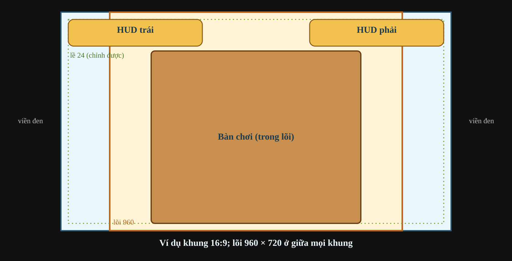
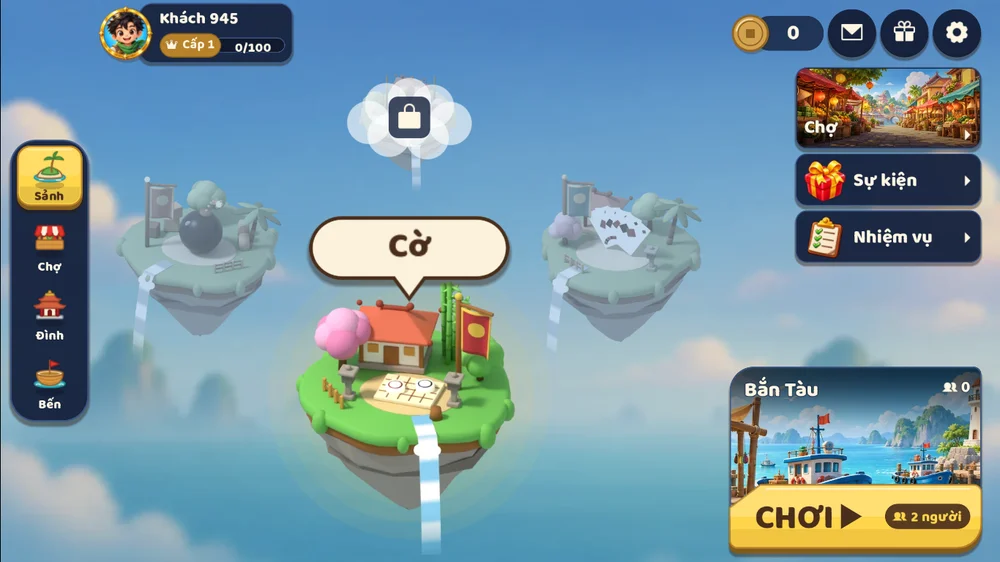

# Giao diện: khung ngang, HUD và bàn chơi

Ứng dụng là một game mobile chơi **xoay ngang**, cài như PWA. Tài liệu này là định hướng chung cho
mọi màn hình: khung hình, đơn vị, chỗ đặt HUD, cỡ chữ và nút, cách dựng bàn chơi và kích thước
hình. Game mới và mọi thay đổi giao diện bám theo đây.

## Khung hình

Mọi thứ được thiết kế trên các **khung cố định cao 720 đơn vị** (`XomDaoFrame` trong
`apps/client/addons/xomdao_sdk/frame.gd`). Khung gốc là 1280 × 720 (16:9),
`stretch/mode = canvas_items`, `stretch/aspect = keep`. `FramePresets` tự chọn một trong bốn
khung dưới đây khi mở ứng dụng, đổi kích thước cửa sổ hoặc xoay máy:

| Tỉ lệ khung | Khung (đơn vị) | Máy thường gặp |
| --- | --- | --- |
| 16:9 | 1280 × 720 | laptop, màn hình máy tính, iPhone SE, điện thoại đời cũ |
| 18:9 (2:1) | 1440 × 720 | điện thoại Android màn dài 18:9 |
| 19.5:9 | 1560 × 720 | iPhone có tai thỏ hoặc Dynamic Island |
| 20:9 | 1600 × 720 | phần lớn điện thoại Android hiện nay |

Ứng dụng chọn khung phủ được nhiều diện tích màn hình nhất mà không cắt hay kéo méo hình;
không có khung tự do, lựa chọn tỉ lệ tuỳ chỉnh hay chế độ `expand`. Máy tính bảng, cửa sổ hẹp
và màn hình dọc dùng khung 16:9; màn rộng hơn 20:9 dùng khung 20:9. Thanh trình duyệt có thể làm
ứng dụng chọn khung khác so với khi chạy PWA toàn màn hình.

- Khung được phóng to hết cỡ mà vẫn giữ tỉ lệ đã chọn, nằm giữa màn hình. Phần thừa là **viền đen**.
  HUD tránh vùng an toàn (`XomDaoFrame.safe_inset`); tai thỏ đã nằm trong viền đen thì không tính
  nữa.
- **Lõi 960 × 720** nằm giữa khung (`XomDaoFrame.core_rect`). Thứ bắt buộc phải thấy (bàn cờ, bài
  trên tay, nút đánh) đặt trong lõi. Hai dải bên cạnh rộng từ 160 đến 320 đơn vị mỗi bên, dành
  cho danh sách người chơi, nút phụ, trang trí.
- Chỉ chơi màn hình ngang.

Ví dụ sảnh trên điện thoại Android 20:9 và laptop 16:9:

## Đơn vị và cỡ tối thiểu

Điện thoại cầm ngang cao khoảng 360 điểm CSS, nên **1 đơn vị ≈ 0,5 điểm CSS** trên điện thoại. Cỡ
tối thiểu tính cho máy nhỏ nhất đó:

| Thứ | Cỡ (đơn vị) | Trên điện thoại |
| --- | --- | --- |
| Vùng chạm nhỏ nhất | 88 × 88 | 44 điểm, cỡ ngón tay |
| Chữ nhỏ nhất (phụ, số điểm) | 24 | 12 điểm |
| Chữ thường, chữ trên nút | 32–36 | 16–18 điểm |
| Tiêu đề, thông báo lớn | 48–72 | 24–36 điểm |

Khoảng cách dùng thang 8 · 16 · 24 · 32 · 48 · 64.

Trong code, `XomDaoSettings.current().ui_scale` là **cỡ HUD** người chơi chọn (1,0 = các cỡ trong
tài liệu này). Cỡ chữ và nút nhân với nó; kích thước bàn chơi thì không.

## HUD

- Trong ván, phần khung chỉ có **nút menu ☰** ở góc trên trái (88 × 88), cách mép một **lề**. Menu
  mở bảng chung: cài đặt, rời phòng, luật chơi, biểu cảm. Bố cục bàn (**Bàn** hoặc
  **Hành động**) ở [experience.md](experience.md#hud-trong-ván); trò để trống ô của nút ☰.
- Không ghi tên game hay tên phòng trong ván: người chơi biết mình đang ở đâu, chỗ đó dành cho bàn.
  Chủ phòng có 👑 trong ô người chơi.
- Người chơi chỉnh được **cỡ giao diện** (Vừa 70% hoặc Lớn 85%, chữ và nút; mặc định Vừa) và **lề màn hình** (12, 24 hoặc 40
  đơn vị) trong bảng cài đặt, lưu theo từng máy (`XomDaoSettings`, `user://settings.cfg`).
- Bảng cài đặt có hai tab. **Giao diện**: cỡ giao diện, lề, chất lượng hình. **Âm thanh**: **nhạc**
  và **hiệu ứng** tách riêng, mỗi thứ có nút bật/tắt và thanh âm lượng (0–100). Mỗi dòng là nhãn
  bên trái, điều khiển bên phải.
- Tab Giao diện có **chất lượng hình** (Thấp, Vừa, Cao). Lựa chọn được lưu lại nhưng chưa đổi cách
  vẽ.
- Mọi màn và mọi bàn dựng nút, bảng, chữ từ bộ thành phần chung trong
  `apps/client/addons/xomdao_sdk/ui/`, nên luôn khớp nhau.

## Thành phần

| Thành phần | Cỡ (đơn vị, ở cỡ HUD 100%) | Ghi chú |
| --- | --- | --- |
| Nút chính (Đánh, Xong, Tạo phòng) | cao 96, chữ 36 | vàng, nền 9-slice |
| Nút phụ (Bỏ lượt, Luật) | cao 80, chữ 30 | xanh hoặc vàng nhạt |
| Nút biểu tượng (âm thanh, cài đặt) | 88 × 88 | |
| Ô lựa chọn (màn tuỳ chỉnh) | cao 80, rộng ít nhất 160 | |
| Ô người chơi | ảnh đại diện 96 (gọn: 72), tên 30, phụ 24 | |
| Bảng, hộp thoại | lề trong 32, bo góc 24 | gỗ và giấy |

- Nền nút và bảng là **9-slice**: góc giữ nguyên hình, chỉ phần giữa giãn. Không bao giờ kéo dãn
  nguyên tấm ảnh (`XomDaoButton`, `XomDaoBoard` đã làm sẵn).
- Mỗi nút có trạng thái thường, sáng lên khi rê chuột, lún khi bấm, mờ khi tắt.

## Bàn chơi

Người chơi phải thấy mình đang ngồi trước bàn: **bàn chiếm gần hết chiều cao**, không có viền dày
hay khung trang trí ăn chỗ.

- **Cờ (Caro, Cờ tướng)**: bàn cờ cao từ ngay dưới hàng HUD tới mép dưới (khoảng 580–690 đơn vị),
  nằm giữa lõi. Bên trái: hai người chơi, đồng hồ, điểm. Bên phải: nút (Xin hoà, Đầu hàng…) và
  dòng trạng thái. Viền bàn cờ mỏng (không quá 4% cạnh bàn).
- **Bài (Tiến Lên, Mậu Binh)**: mặt bàn (nỉ, hay chiếu cói như Tiến Lên) phủ kín cả màn hình;
  mép bàn nếu có chỉ là một đường viền mỏng. Bài trên tay nằm ở dải dưới (lá cao khoảng 150–180), đối thủ ở mép trên và hai bên, chồng
  bài đánh ra ở giữa. Nút đánh ở góc dưới phải, ngay trên hoặc cạnh bài trên tay.
- Hiệu ứng (bài bay, quân đi, chữ "Chặt heo!") nằm trong khung, không đè lên HUD.

## Hình và kích thước

- Hình phải đủ điểm ảnh cho lúc phóng to nhất: **cỡ ảnh ≥ cỡ hiển thị (đơn vị) × 2,3**. Ví dụ một lá
  bài cao 160 cần ảnh cao ít nhất 368; một quân cờ 68 cần ảnh 160.
- Ảnh to hơn nhiều so với cần thì thu nhỏ lại khi xuất, cho nhẹ và mượt.
- Soi độ nét bằng `npm run shots -- --path '<trang>'` trên `ipad` (phóng to nhất), ở các file
  `-crop.png`. Đặt kích thước hình theo đơn vị thiết kế (không theo điểm ảnh của ảnh), để xuất
  ảnh to hơn không làm hình to ra.
- Nền nút, nền bảng cần ghi độ dày viền (để đặt `slice`) khi làm hình.

## Chuyển động

- Mục tiêu 60 khung hình mỗi giây trên điện thoại tầm trung.
- Hiệu ứng dùng `Tween` đổi vị trí, tỉ lệ, độ trong suốt. Tránh đổi chữ hay cỡ chữ trong lúc chạy
  hiệu ứng: chữ phải vẽ lại mỗi lần đổi.
- Đo trên máy thật: cắm điện thoại, mở `chrome://inspect` trên máy tính, dùng tab Performance.

## Kiểm tra

- `npm run shots -- --path '/?play=<id>'` chụp một màn trên nhiều máy thật (xoay ngang, đúng mật độ
  điểm ảnh). Dòng in ra so mật độ canvas với màn hình; soi độ nét ở các file `-crop.png`.
- Thử cả màn hình hẹp nhất (iPad, 4:3) và rộng nhất (điện thoại 20:9): khung phải nằm giữa, viền
  đen đều hai phía.
